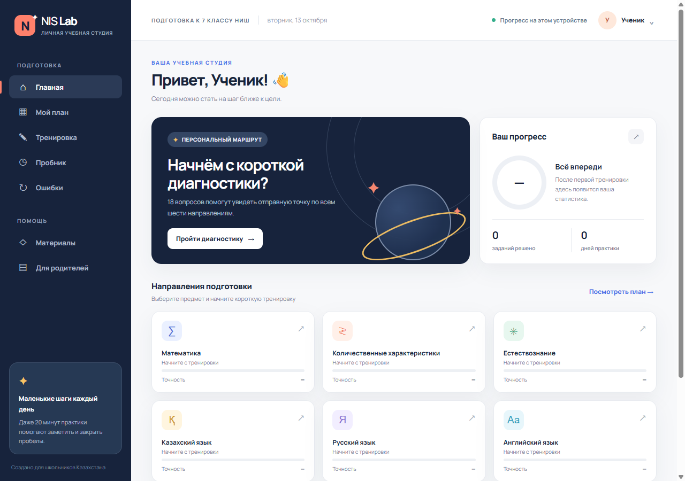

# NIS Lab · Workshop edition

This version adds a local question-bank workshop with draft review, translations, and import/export. The student practice experience remains available alongside it.

NIS Lab is a Russian-language browser practice platform for students in Kazakhstan preparing for the entrance selection process to the 7th grade of NIS schools. It is an independent portfolio project maintained by [@LordGibrat](https://github.com/LordGibrat).

**[Open the original live platform →](https://lordgibrat.github.io/nis-lab-kazakhstan/)** · [Run this version locally](#developer-workshop-local-first)

No server, account, or API key is required. The app can also be downloaded and opened directly from `index.html` in Chrome or Edge.

## What the prototype includes

- Separate student profiles with browser-local progress.
- An 18-question diagnostic across six subject areas.
- Focused practice sets and mixed-subject practice.
- Rule-based selection that prioritises weaker topics and unanswered questions.
- Immediate explanations and an error-review loop.
- A 24-question, 25-minute mini mock exam with subject-level results.
- A parent view with accuracy, activity statistics, and CSV/JSON export.
- Links to official and supplementary preparation resources.

The bank contains 75 authored questions and 52 programmatically generated, checkable numerical variants in mathematics and quantitative reasoning (127 tasks in total). The “adaptive” selection is a transparent rule system based on answer history; it does not use a generative model or paid API.

## Scope and limitations

NIS Lab is an independent practice tool, not an official NIS product or exam. NIS is not affiliated with the project, and the statistics describe activity inside this app rather than predicting admission outcomes.

Progress is stored in the browser’s `localStorage`. Export a backup from the parent section before switching browsers or clearing site data.

## Sources and design

- [NIS sample entrance tasks](https://www.nis.edu.kz/ru/page/konkurstyq-irikteu-tapsyrmalarynyn-ulgileri)
- [NIS Pedagogical Measurements Centre course](https://www.academia.kz/ru/course/38)
- [Official NIS practice test](https://www.nis.edu.kz/ru/page/baiqau-testileui)

The interface composition was informed by educational product references; the layouts and graphics in this repository were created for NIS Lab.

## Developer workshop (local-first)

Open `developer.html`, or use **Мастерская** in the student navigation. For consistent shared browser storage between both pages, serve this directory locally (`python -m http.server 8000`) and open `http://localhost:8000`. Direct file opening can have browser-specific storage isolation; no server/API is required for the application itself.

- Browse the original 127 questions and your own questions by subject, topic, status, and search.
- Create questions, copy built-in questions, edit your own questions, and record answers, explanations, attribution and reuse permission.
- Inspect bank/topic coverage, set your own per-topic target counts, and view current-profile local accuracy. Targets default to 5; these are personal planning goals, not official NIS requirements or admission predictions.
- Import/export a versioned JSON bank. Export includes custom questions, nested translations and topic targets, but **not student profiles or answer history** (export those from the existing parent page).
- All imported records become drafts. Explicitly check the original, translations, answer and rights in the editor to enable a question in student practice. Opening an existing record resets the review checkbox until you re-confirm it on saving.
- Select Russian, Kazakh or English for question display. Missing translations fall back to the original text. The original 127-question bank and surrounding interface are not fully translated. In the editor, select the display language first; Kazakh/English fields are saved separately under the same question ID. Answer indices are shared, so preserve option ordering across languages.

### Starter questions and sources

`starter-bank.json` contains **15 unique mathematics questions with Russian originals plus Kazakh and English translations** (45 language variants, not 45 unique problems). Download it from the Sources tab and import it. All start as drafts awaiting human review. Adaptations are from Illustrative Mathematics materials under CC BY 4.0; each question preserves the precise source, author, license, and changes in `source`. They are supplementary grade-level practice, not official NIS questions or comprehensive exam coverage. Original answer/option ordering is preserved across translations.

`sources.js` contains ten verified official/reference and openly licensed resource entries. Official NIS samples are link-only because an open republication license was not established. Sample topics are illustrative, not an exhaustive syllabus. Exam timing comes from the real-exam memo, distinct from the trial-test timing. Source URLs were checked on 2026-10-14.

### Storage, backup and recovery

This is **not an authenticated or secure online admin panel**. Anyone using the same browser/origin can inspect or change its data. There is no backend, account, cloud database, GitHub publication or cross-device sync. Changes are local and persist in browser `localStorage`. Storage can be cleared, blocked or filled; export backups regularly and before switching browsers.

Import is additive: duplicate IDs reject the entire question import rather than overwriting existing data. To restore a full backup, use a clean browser profile/origin, import it, then re-review questions. Existing topic targets win over imported targets. Do not clear a browser containing irreplaceable student progress. A corrupt question bank disables writes to preserve raw data; use a known-good export in a clean profile rather than resetting the existing profile. A second workshop tab changing the bank locks further writes until reload, preventing silent overwrite. Question and target storage are separate writes; if targets fail after question import, the page explicitly reports partial success. There is no delete action in this version, preserving question IDs referenced by past attempts. Uncheck review to remove a custom question from new practice; historical accuracy remains.

Do not alter the meaning/answer of a question already used by students: create a new question instead. The editor rejects changing Russian option ordering/answer if translations exist, and the translated editor cannot change the shared answer. All topic/history calculations use the original topic, so translating does not inflate coverage or split results.

### Validation

- `node --test tests/bank-store.test.js`: schema, JSON parsing, source URLs, duplicate/atomic merge, storage failures, size limits, translation roundtrip.
- `node --check app.js && node --check developer.js && node --check bank-store.js`.
- Optional real-browser integration: install Playwright from its official package, run a local server on port 8765, then `node tests/browser.cjs`. Set `CHROMIUM_PATH` if Chromium is elsewhere; `NIS_BASE_URL` overrides the server URL.

Real Chromium integration and visual screenshots were attempted in the cloud build environment but blocked by its Unix-socket policy; no visual/browser pass is claimed. A runnable browser test is included for a suitable environment. The existing 24-question mini mock remains intentionally unchanged.
